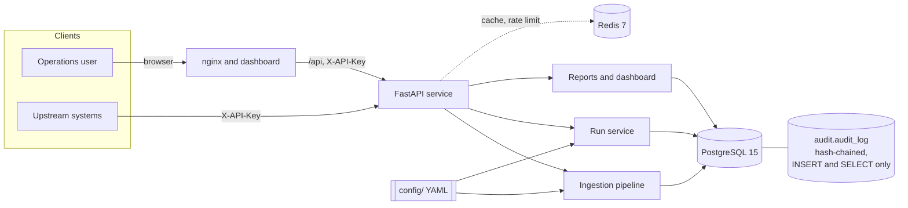
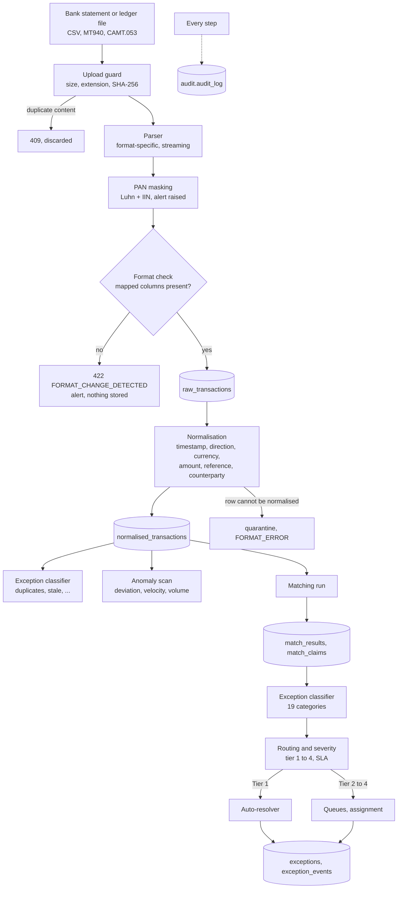
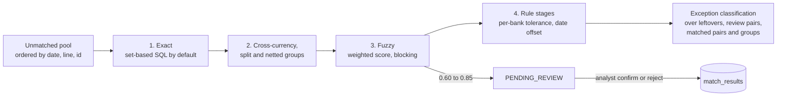

# Architecture

How the engine is put together as built (not as first planned): the components, the data
flow from a bank file to a closed exception, the run lifecycle, and where each concern lives
in the repository. Decisions and deviations from the specification are numbered (AE, IB, DD)
in [ASSESSMENT_ERRORS_AND_CORRECTIONS.md](ASSESSMENT_ERRORS_AND_CORRECTIONS.md).

## Shape

A single FastAPI service in front of PostgreSQL 15 (system of record, including the
append-only audit schema) and Redis 7 (dashboard cache and rate-limit counters, both
fail-open). There is no separate worker process: a run executes inside the request that
starts it, or as a FastAPI background task when it was queued (DD-16, DD-26). Everything that
varies per bank or per policy is configuration (`config/`), not code.

## Data flow

## Matching run

A run is per bank, optionally over a date range, in `FAST` (exact stages only) or `FULL`
mode. The stage order differs from the specification's flat hierarchy on purpose (DD-23).

Every match is written with a claim (`match_claims`): at most one ACTIVE claim per
transaction is enforced by a partial unique index, so two stages, two runs or two requests
can never consume the same transaction. A rejected (internal, external) pair is recorded
and no stage proposes it again.

## Run lifecycle

`PENDING` (queued, e.g. backlog recovery) to `RUNNING` to `COMPLETED` or `FAILED`. At most one
active run per bank (a `RUNNING` row older than 30 minutes is reaped as `FAILED`). Run
creation requires an `Idempotency-Key`: the same key returns the same run, the same key with
a different bank is a 409. Run state changes and a SHA-256 digest of the match summary are
written to the audit trail.

## Repository map

| Path | Responsibility |
| --- | --- |
| `src/recon/domain/` | Pure types: `Money` (Decimal and minor units), canonical transaction, enums. No I/O. |
| `src/recon/config/` | Pydantic models and loaders for bank, matching and taxonomy configuration; hot-swappable `BankConfigRegistry`; versioned store and validator (`validate_bank_config` CLI). |
| `src/recon/ingestion/` | Upload guard, parsers (`csv_parser`, `mt940/`, `camt053/`), PAN masking, format-change detection, MT940/CAMT balance reconciliation, file integrity re-verification, the `IngestionPipeline` that sequences them. |
| `src/recon/normalisation/` | Timestamps (bank time zone to UTC), direction, currency, amounts, references, counterparty names. |
| `src/recon/matching/` | `MatchingOrchestrator`; strategies (`exact`, `exact_set_based`, `group`, `cross_currency`, `fuzzy`, `rule_based`); `blocking/`, `scoring/`, `rules/`, `subset_sum`, `claims` ledger, `review` and `manual` workflows. |
| `src/recon/excmgmt/` | Pair analysis and classifier (19 categories), routing and severity, SLA scanner, escalation, queues, `autoresolve/`. |
| `src/recon/anomaly/` | Rolling per-counterparty statistics, alert rules, rate alerts, absence checks. |
| `src/recon/fx/`, `calendar.py` | Exchange-rate store, conversion with INR pivot, outlier flagging; Indian business-day calendar. |
| `src/recon/audit/` | Canonical serialisation, `AuditLogger`, chains, verifier. |
| `src/recon/runs/` | `RunService`, `RunSettings`, backlog recovery. |
| `src/recon/reporting/`, `analytics/` | Daily, ageing, audit-compliance and recovery reports (JSON, HTML, CSV); dashboard aggregates. |
| `src/recon/api/` | Routers under `v1/`, authentication and RBAC, rate-limit middleware, schemas. |
| `src/recon/persistence/` | SQLAlchemy models, repositories, session. Migrations are in `migrations/`. |
| `src/recon/samples/`, `bench/`, `cli/` | Deterministic sample and golden data, benchmarks, command-line tools (`seed`, `golden`, `benchmark`, `create_api_key`, `validate_bank_config`). |
| `config/` | `banks/*.v1.yaml` (7 banks) and `_schema.json`, `matching/weights.yaml`, `exceptions/taxonomy.yaml`, `anomaly/rules.yaml`, `calendars/in-2026.yaml`. |
| `tests/` | `unit/`, `integration/` (real PostgreSQL), `golden/`, `chaos/`, `security/`, `performance/`. |
| `frontend/` | The web dashboard (React, TypeScript, Vite), served by nginx which also proxies `/api` to the engine; types generated from the engine's OpenAPI schema. See `frontend/README.md`. |

## Persistence

Public schema: `ingestion_files`, `raw_transactions` and `normalised_transactions` (both
range-partitioned by month with a default partition), `match_results`, `match_claims`,
`reconciliation_runs`, `exceptions`, `exception_events`, `ledger_adjustments`, `alerts`,
`counterparty_stats`, `fx_rates`, `statement_balances`, `bank_configurations`, `users`,
`api_keys`. Audit schema: `audit.audit_log`, written through a role that has INSERT and SELECT
only. See [DATABASE.md](DATABASE.md).

## Principles that shaped the code

- **Money is never a float.** Decimal in the domain, integer minor units in storage, per-currency
  precision (AE-17). A float anywhere in an audit payload is rejected.
- **Nothing is silently dropped.** A row that cannot be parsed or normalised becomes a quarantined
  record and a FORMAT_ERROR; a file that no longer matches its bank's mapping is refused loudly.
- **Determinism.** Unmatched pools are ordered by `(date, source line, id)`; the same input
  produces the same matches and the same sample data from the same seed.
- **Policy lives in configuration.** Weights and thresholds, SLAs, tiers, tolerances, calendars,
  fee schedules and anomaly rules are YAML, validated against schemas at load time.
- **The audit trail is a product feature**, not logging: hash-chained, append-only at the database
  level, verifiable through the API, anchored by exported chain heads (DD-12).
